# Pratham Kashyap

**Software Engineer — Backend Systems & AI/ML Applications**

B.Tech CSE (AI & ML), VIT Bhopal · India · Graduating 2027

I build backend systems and AI/ML applications with an emphasis on correctness and
reliability — concurrency control, caching, persistence, failure handling, and
automated test coverage as first-class design concerns rather than afterthoughts.

My recent work spans backend infrastructure, applied AI, and full-stack systems, with
selected applications available as live demos. Each project is documented and backed by an
explicit test suite with CI gates.

---

## Engineering Focus

**AI Infrastructure** — Inference gateways, request deduplication, circuit breaking,
provider failover, hybrid retrieval (BM25 + dense + RRF), token streaming

**Backend Engineering** — Layered REST architecture, relational modelling, pessimistic
locking, keyset pagination, OAuth2/OIDC, RBAC, schema migrations

**Testing & Quality** — Unit, integration, E2E and concurrency suites; coverage gates in
CI; deterministic mocks and offline test harnesses

**Applied ML Systems** — Retrieval grounding, spaced-repetition scheduling, geospatial
classification, evidence-tracked evaluation

**Algorithms** — C++20, DSA, multi-platform competitive programming

---

## Featured Work

###  &nbsp;[AI Systems Lab](https://github.com/prathamkashyap/ai-systems-lab) · `Python` `FastAPI`

A routed LLM inference gateway built as infrastructure rather than a notebook. Applies
TTL+LRU caching, SingleFlight in-flight request deduplication, micro-batching, circuit
breaking, and failover across Anthropic, OpenAI-compatible backends (Ollama, vLLM,
DeepSeek, Groq), and a deterministic `MockProvider` so the entire test path runs offline
with zero API keys.

Hybrid retrieval fuses BM25 lexical search with dense vectors via Reciprocal Rank Fusion,
backed by a RAG evaluation suite (context precision/recall, keyword coverage,
faithfulness). Ships SSE token streaming, Prometheus metrics, and an interactive playground.

**Measured** — 200 concurrent duplicate prompts: 297.7 ms → 45.5 ms wall time via
SingleFlight (99.5% deduplication, one provider call).

Runs locally with `uvicorn`; no public deployment.

`40 tests` · `ruff` lint · `CI on Python 3.11/3.12` · `Docker` · `5 ADRs` · `MIT`

[Repository](https://github.com/prathamkashyap/ai-systems-lab) ·
[Architecture](https://github.com/prathamkashyap/ai-systems-lab/blob/main/system-design/architecture.md)

---

###  &nbsp;[Libris](https://github.com/prathamkashyap/libris) · `Java 21` `Spring Boot 3.5`

A library management platform built to production conventions. Layered REST
(Controller → Service → Repository) on Spring Security 6.5 with session auth via BCrypt
and opt-in Google OAuth2/OIDC, URL-pattern RBAC across Admin / Librarian / Student, and
CSRF protection.

Persistence work includes Flyway-versioned migrations (V1–V5), pessimistic locking for
borrow/return race protection, N+1 prevention via `EntityGraph`, cache eviction on
mutation, SQL-level overdue filtering, and keyset pagination for large report queries.

OCI deployment configuration is prepared but no live instance is verified; earlier Railway
and Render deployments have been retired.

`175 tests / 17 classes` · `JaCoCo ≥70% gate (90.3% last verified)` · `Spotless` ·
`ArchUnit` · `9 concurrency tests` · `Docker (amd64 + arm64)` · `9 engineering docs` · `MIT`

[Repository](https://github.com/prathamkashyap/libris) ·
[Deployment guide](https://github.com/prathamkashyap/libris/blob/main/docs/DEPLOYMENT.md)

---

###  &nbsp;[AthenaeumAI](https://github.com/prathamkashyap/AthenaeumAI) · `React` `Node.js` `MongoDB` `Redis`

A deployed adaptive-learning platform that ingests uploaded material and derives per-topic
mastery, confidence, and exponentially decayed retention from recorded attempts.

The distinction that matters: the LLM writes questions and explanations — it never computes
mastery, confidence, decay, or review scheduling. Those are deterministic calculations over
stored attempts. Quiz generation is synchronous and can take minutes; only indexing and
attempt-sync are enqueued to BullMQ, and the API reports honestly when background work was
not scheduled.

The shipped retriever is a measured lexical baseline (`local-hash-v1`), documented as such —
a full BM25 implementation exists for comparison but is not on the active path.

| Suite | Passed | Skipped |
|-------|-------:|--------:|
| Frontend (Vitest) | 374 | — |
| Backend unit (Jest) | 942 | — |
| Backend integration (Jest) | 101 | 13 |
| Browser E2E (Playwright) | 26 | 2 |

Skipped tests are gated behind opt-in flags requiring live infrastructure; they are
reported rather than silently passing. `CI gates typecheck · lint · build` · `MIT`

**Live** — [athenaeumai.tech](https://athenaeumai.tech) ·
[API health](https://api.athenaeumai.tech/api/v1/health) ·
[Swagger](https://api.athenaeumai.tech/api-docs/)

[Repository](https://github.com/prathamkashyap/AthenaeumAI)

---

###  &nbsp;[Fact Knowledge Layer](https://github.com/prathamkashyap/fact-knowledge-layer) · `Python` `FastAPI` `SQLite`

A deterministic pipeline for grounded cross-document fact extraction and epistemic
reasoning, built for a VIT engineering internship assignment. Parses multi-page PDFs,
extracts structured assertions, and links every fact to a document, page number, and
verbatim source sentence before persisting it.

Cross-document fact pairs are classified as `CORROBORATES`, `RECONCILABLE`, `CONTRADICTS`,
`UNCERTAIN`, or `UNRELATED` — a numeric difference is not automatically a contradiction
when estimate vintage or reporting scope explains it. Runs fully offline through an
`LLMProvider` abstraction with a deterministic mock.

Runs locally from a FastAPI server; no public deployment.

`300 tests` · `pytest` · `hand-verified gold sets (27 extraction / 30 relationship)` ·
`precision 1.0000 · F1 0.9200 · relationship accuracy 30/30`

[Repository](https://github.com/prathamkashyap/fact-knowledge-layer)

---

## Additional Projects

**[Civic Lens](https://github.com/prathamkashyap/civic-lens)** — Geospatial ML for civic
complaint triage. KNN spatial-density features, DBSCAN hotspot detection, and XGBoost
prioritisation, evaluated on 5,469 real NYC 311 records (95.7% with direct training; 65.3%
zero-shot from synthetic data, quantifying cross-city domain shift). The repository
documents that the main dataset is synthetic and that high direct-training accuracy should
be read cautiously, since status-derived labels partially correlate with the target. React,
TypeScript, Firebase, Leaflet.
`React` `TypeScript` `Firebase` `Python` `XGBoost` · [Live](https://civic-lens-platform.vercel.app)

**[Evidence-Driven Dataset Intelligence](https://github.com/prathamkashyap/evidence-driven-dataset-intelligence)** —
A research artifact, not a production system. Local-first dataset recommendation with a
two-layer evidence ledger (observation states and cross-evidence resolution states kept
distinct), bounded fingerprinting, hard compatibility gates, multi-objective ranking, and
family-aware greedy diversification. Fixed seeds, no network egress during evaluation, and a
measured 128 MiB / 20 s envelope. M0–M8 frozen milestones plus an exploratory N = 3 human pilot.
`208 tests` · `M0–M8`

**[AI Smart Retail & Customer Intelligence](https://github.com/prathamkashyap/AI-Smart-Retail-Customer-Intelligence-Platform)** —
Computer vision, NLP, and a hybrid chatbot behind one FastAPI gateway. OpenCV facial
encodings stored instead of raw images (privacy by design), MobileNetV2 product
classification, and TF-IDF + logistic-regression review sentiment.
[Live dashboard](https://ai-smart-retail-customer-intelligence.vercel.app)

---

## Skills

**Languages** — C++20 · Python · Java 21 · TypeScript · JavaScript · SQL

**Backend & Infrastructure** — Spring Boot · Spring Security · FastAPI · Node.js · Express ·
REST API design · MySQL · MongoDB · Redis · BullMQ · Flyway · OAuth2/OIDC · RBAC ·
Docker · GitHub Actions · Linux · Prometheus

**AI / ML** — Retrieval pipelines (BM25, dense vectors, RRF) · RAG · LLM provider APIs
(Anthropic, OpenAI-compatible, Groq) · scikit-learn · XGBoost · OpenCV · PyTorch ·
SSE streaming · Spaced repetition · RAG evaluation

**Testing & Quality** — pytest · JUnit / MockMvc · Jest · Vitest · Playwright · JaCoCo ·
ArchUnit · concurrency testing · deterministic mock providers · coverage gating in CI

---

## Algorithms & Competitive Programming

I regularly practise data structures and algorithms across competitive-programming
platforms to sharpen problem-solving and algorithmic thinking. My solutions, reusable
templates and notes are available in the
[competitive-programming](https://github.com/prathamkashyap/competitive-programming)
repository, where compilation of every C++ file is validated in CI.

---

## Currently Exploring

- Model Context Protocol (MCP) and autonomous coding-agent architecture
- Streaming and partial LLM generation to cut end-to-end generation latency
- Sentence-transformer embeddings and cross-encoder reranking as a measured upgrade
  path over lexical retrieval

---

## Contact

**Certifications & achievements** — TCS CodeVita Season 13 global rank 3,633 · Oracle
Certified Foundations Associate in Agentic AI (2026) · NPTEL Introduction to IoT (Elite +
Gold, top 5%, 90) · NPTEL Cloud Computing (Elite + Silver, top 2%, 88) · Applied Machine
Learning in Python, University of Michigan (Coursera)